# Cued Starter UI Flow

This folder captures the workflow image iterations and the SwiftUI preview renders for the starter app flow.

## Imagegen Workflow Concepts

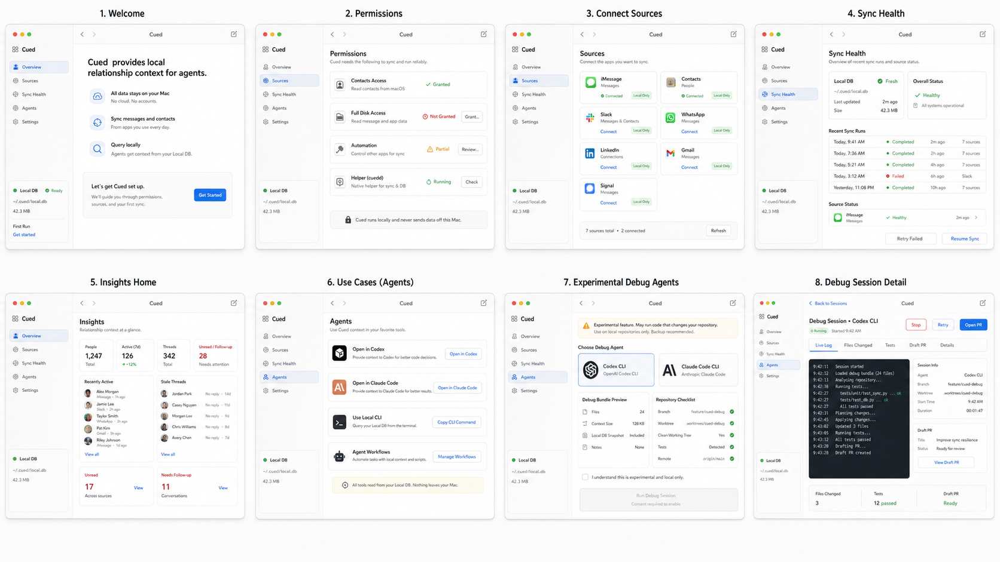

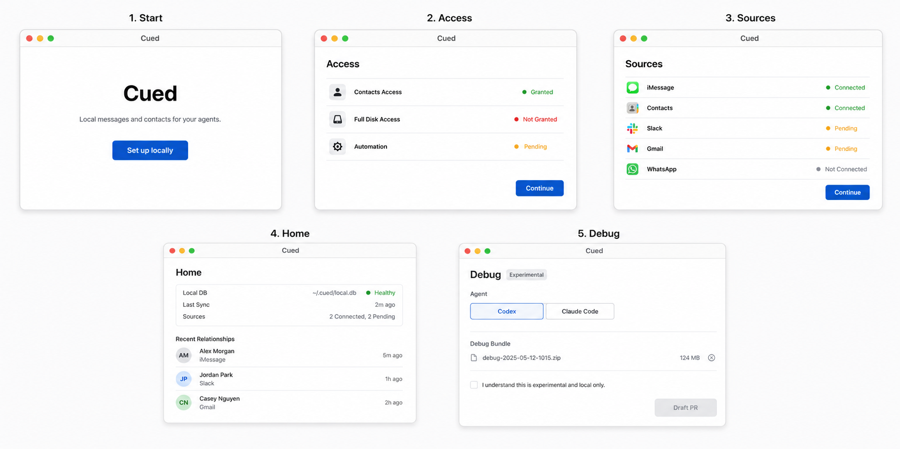

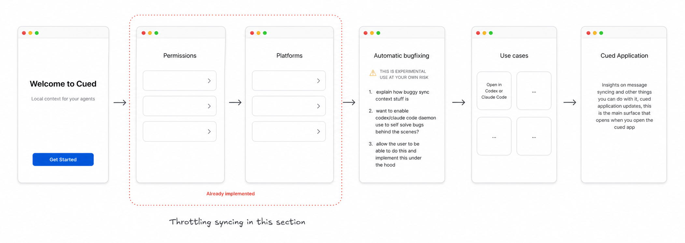

## SwiftUI Preview Renders

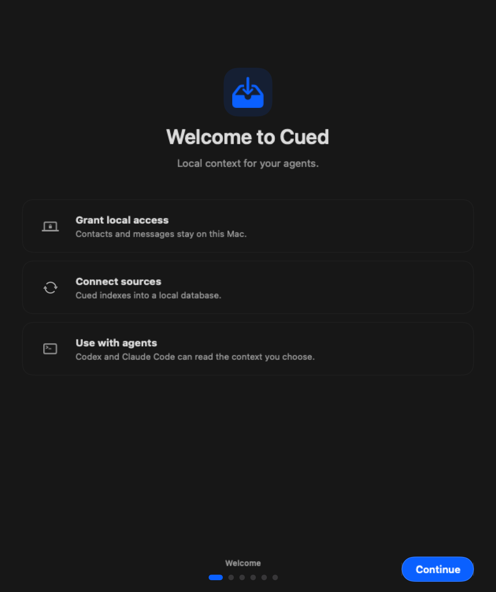

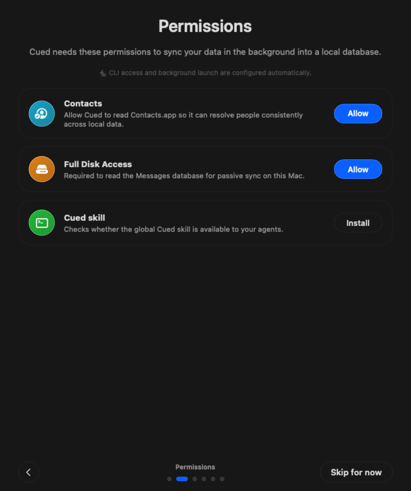

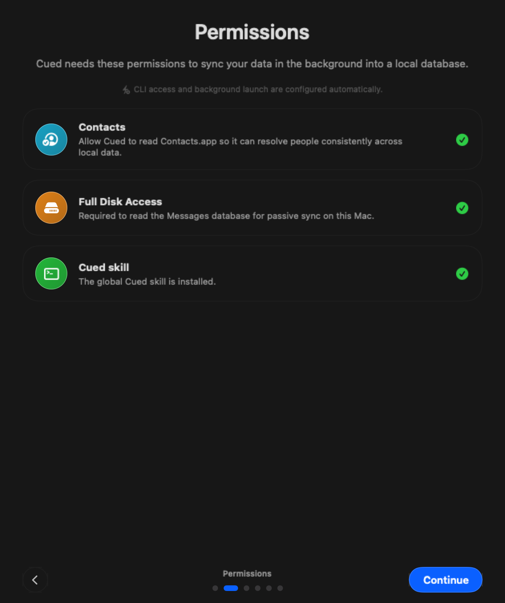

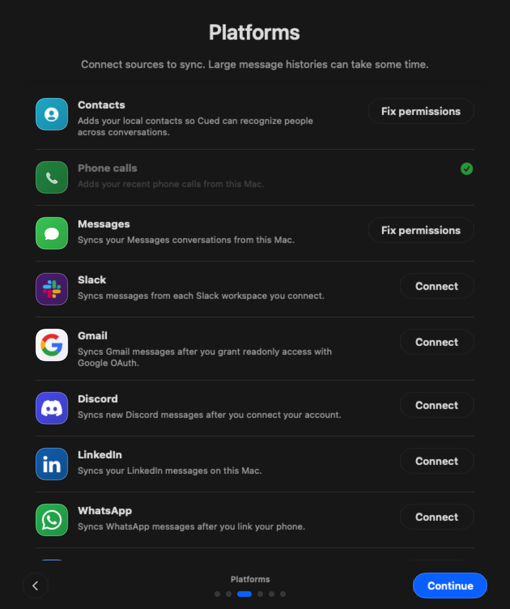

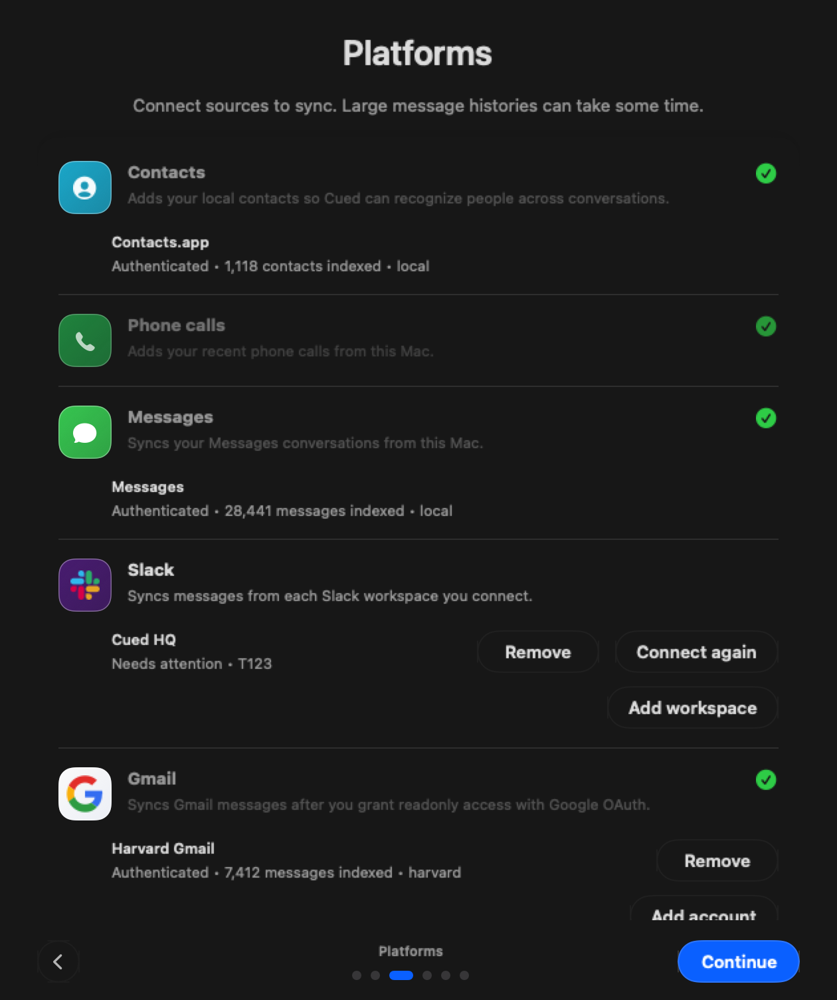

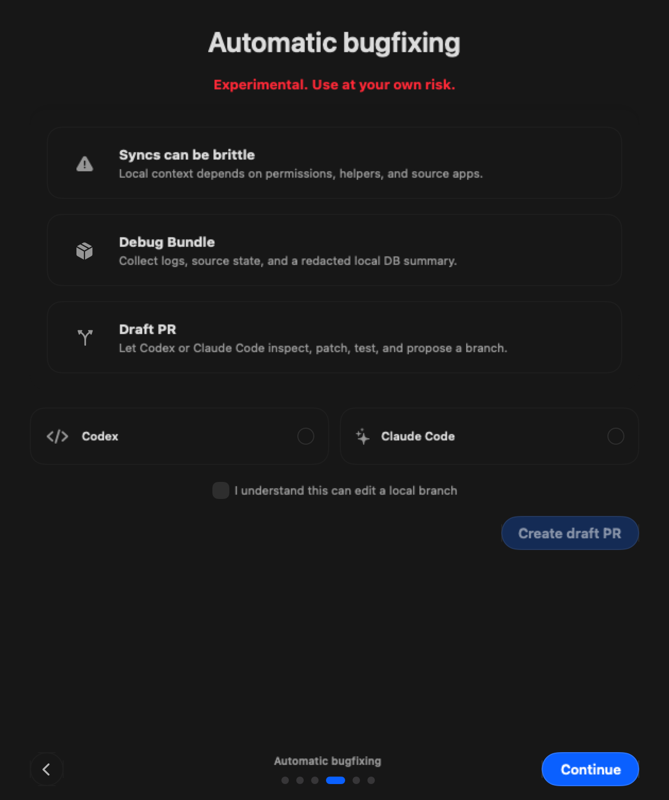

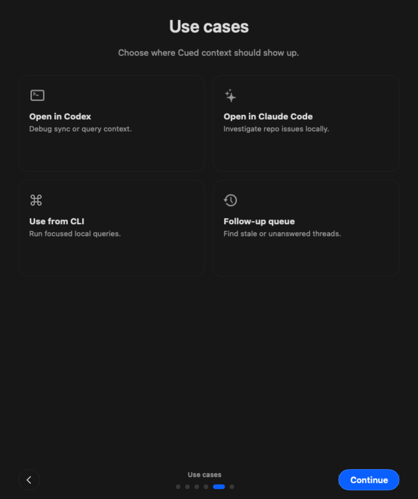

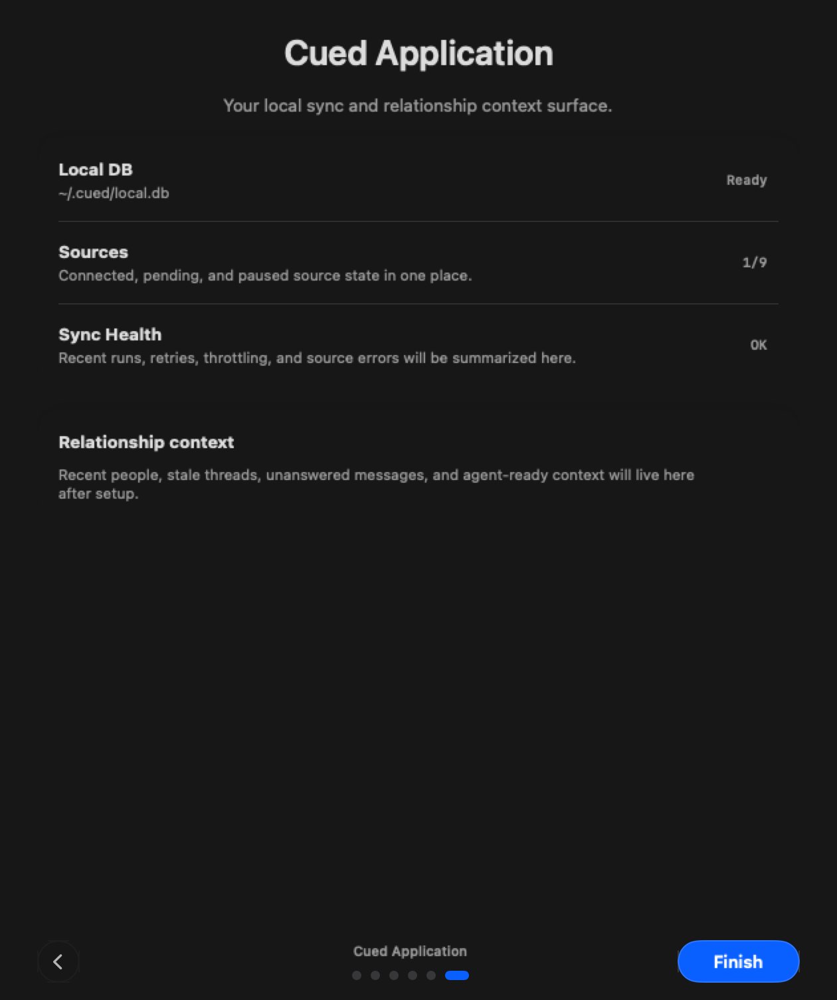
